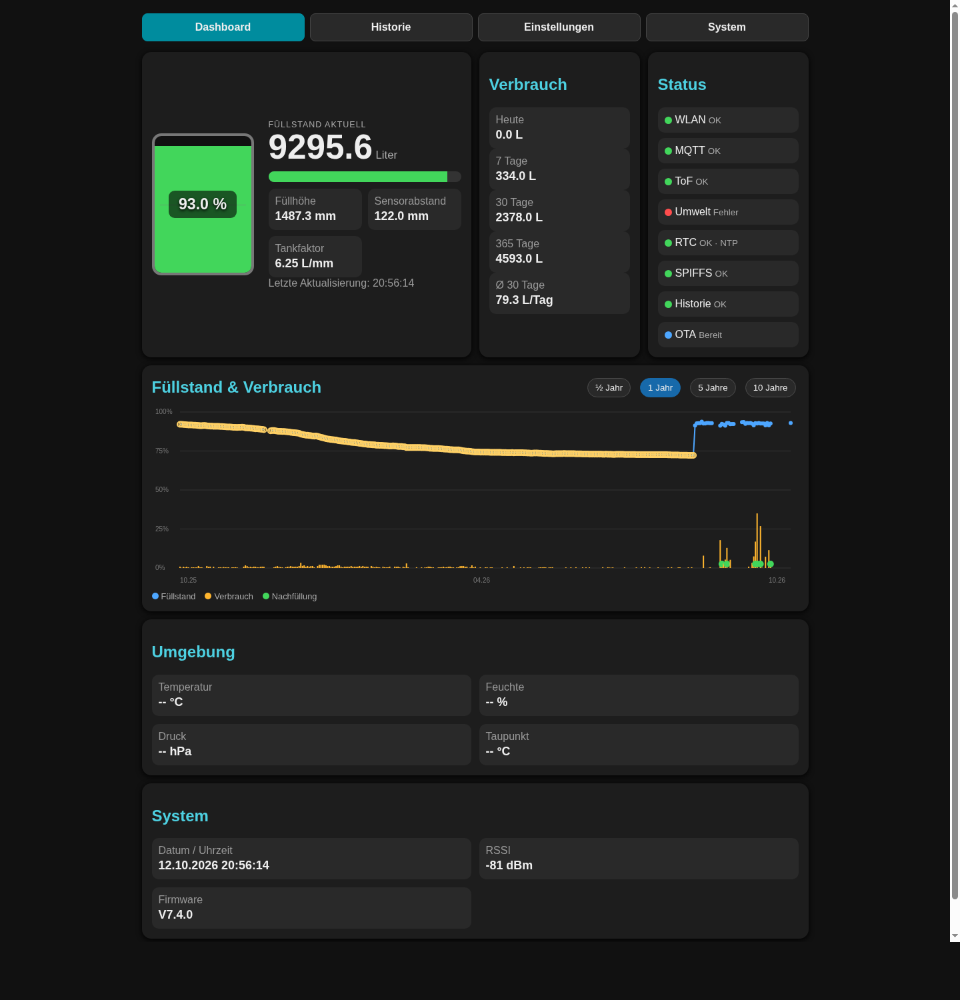
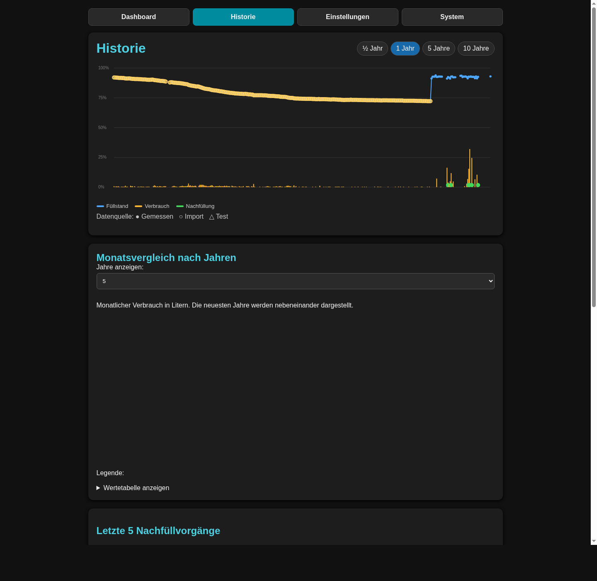
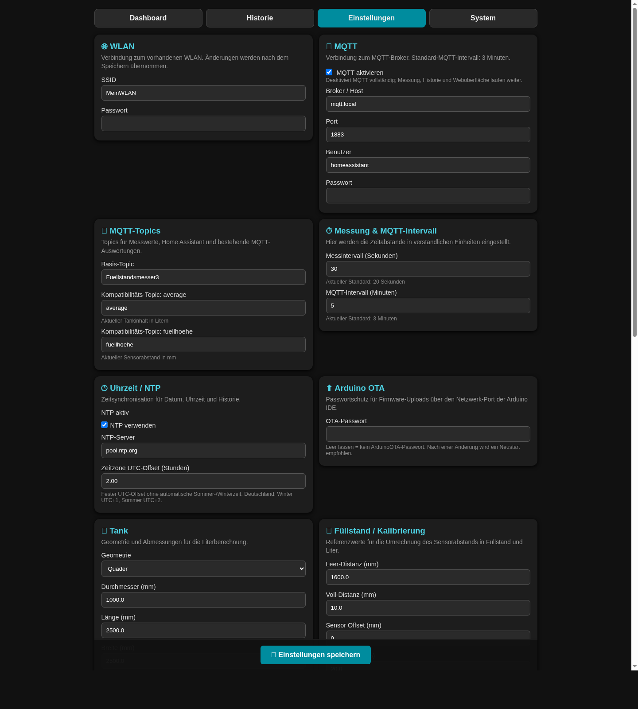
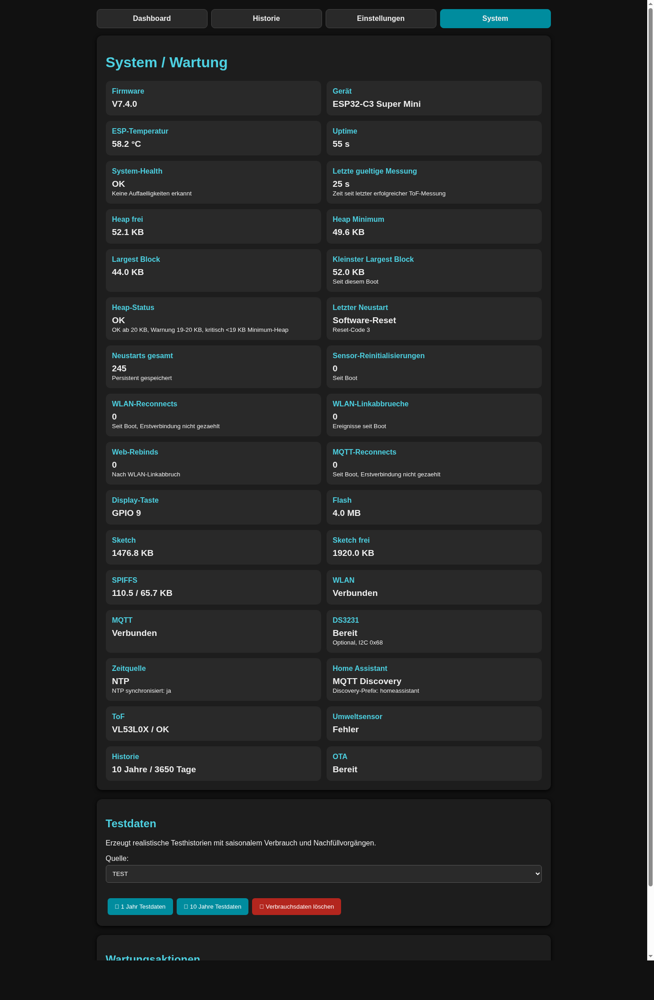

# Fuellstandsmesser3 V7.4.0 – Projektpräsentation

## Der Tankmonitor auf einen Blick

Fuellstandsmesser3 verbindet berührungslose ToF-Messung mit lokaler Anzeige,
einem responsiven Web-Dashboard, zehn Jahren Tageshistorie und offener
Smart-Home-Integration. Die Firmware läuft auf einem ESP32-C3 und bleibt auch
bei Ausfall von WLAN, MQTT, NTP oder der optionalen RTC messfähig.



## Messung und Aufbereitung

```text
ToF-Sensor -> Plausibilität -> Median/Mittelwert -> Tankgeometrie
                                                    |
                     +------------------------------+------------------+
                     |              |               |                  |
                    OLED        Web/API          MQTT/HA        Tageshistorie
```

- VL53L0X, VL53L1X und VL53L5CX werden automatisch unterschieden.
- Die Messung liefert Abstand, Füllhöhe, Prozent und Liter.
- Nachfüllungen und Verbrauch werden aus bestätigten Tageswerten abgeleitet.
- Nicht plausible Werte gelangen nicht in Anzeige, MQTT oder Historie.

## Oberfläche und Historie



Die Weboberfläche enthält Dashboard, Historiencharts für ½, 1, 5 und 10 Jahre,
Monatsvergleiche, Kalibrierung, CSV-Import/-Export und Wartungsfunktionen. Die
Historie nutzt zwei CRC-geschützte SPIFFS-Banken und atomisches Schreiben.

## Einstellungen



Messintervall, Tankgeometrie, Sensoradressen, WLAN, MQTT, NTP, Anzeige und
Kalibrierung bleiben direkt im Browser administrierbar. Die Seite wird komplett
aus der Firmware ausgeliefert; es gibt keine separate Webinstallation.

## RTC und Umweltmessung

- BME280 liefert Temperatur, Feuchte, Druck und Taupunkt.
- BMP280 liefert Temperatur und Druck; nicht verfügbare Werte bleiben leer.
- Eine DS3231 auf `0x68` liefert beim Offline-Start sofort eine gültige Zeit.
- NTP bleibt die bevorzugte Referenz und aktualisiert die RTC.
- Dashboard und API zeigen RTC-Erkennung, Gültigkeit und aktive Zeitquelle.
- Das AT24C32-EEPROM vieler RTC-Module wird in V7.4.0 nicht beschrieben.

## Systemdiagnose



Die Systemseite zeigt unter anderem freien und minimalen Heap, größten
zusammenhängenden Block, Resetursache, Neustartzähler, Sensor-Reinitialisierung,
WLAN-/MQTT-Reconnects, RTC, Zeitquelle und Speicherbelegung.

## Schnittstellen

| Schnittstelle | Zweck |
|---|---|
| `/api/status` | vollständiger Livezustand als JSON |
| `/api/ping` | schneller Health-, Heap- und Uptime-Check |
| MQTT | Livewerte und kompatible Bestands-Topics |
| Home Assistant | automatische MQTT-Discovery |
| CSV | Sicherung und Wiederherstellung der Tageshistorie |
| Web-OTA / ArduinoOTA | Firmwarewartung |

## Validierung V7.4.0

- Build mit ESP32 Arduino Core 3.3.11 bestanden
- Upload auf das registrierte ESP32-C3 verifiziert
- serieller Hardwaretest mit realem VL53L0X, OLED und DS3231 bestanden
- DS3231 beim Offline-Start gelesen und nach NTP synchronisiert
- BME280-/BMP280-Erkennung erfolgreich gebaut; der aktuell angeschlossene
  Umweltsensor meldete im V7.4.0-Abnahmelauf keine gültige Chip-ID
- VL53L0X anhand Modell-ID erkannt
- 120 Einstellungsseiten-Aufrufe ohne Timeout, Retry, Neustart oder Heap-Trend

## Grenzen

- Messqualität hängt von Montage, Oberfläche, Geometrie und Kondensation ab.
- Das Projekt ist nicht eichfähig und kein Ex-/ATEX-System.
- Es ersetzt keine vorgeschriebene Überfüll- oder Leckagesicherung.
